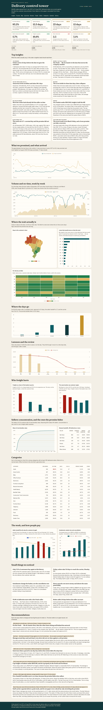
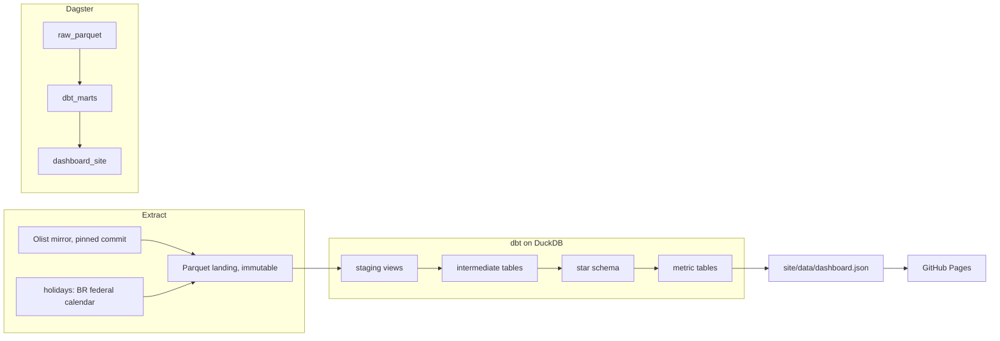

# Delivery control tower

An end-to-end logistics analysis of the public Olist Brazilian marketplace orders: a reproducible warehouse, tested metrics, and a static control tower for people who run delivery rather than pipelines.

The business question is simple. The on-time rate looks healthy. Is the operation actually fast, or is the promise doing the work? Where does a late order lose the days, what does that do to the review, and which lanes, sellers and baskets are carrying a cost the average hides?

**Live dashboard:** [luciferdataengineer.github.io/supply-chain-control-tower](https://luciferdataengineer.github.io/supply-chain-control-tower/)



A 390px capture is in [docs/dashboard-mobile.png](docs/dashboard-mobile.png).

## What the closed cohort shows

Orders placed from 5 January 2017 through 31 August 2018. The window filter is 1 January 2017 inclusive to 1 September 2018 exclusive; the first and last orders in that window fall on 5 January 2017 and 31 August 2018. September and October 2018 are a handful of orders, none of them delivered. 2016 is a thin pilot (a few hundred orders, and November is missing). Both are kept in the facts and excluded from every KPI below.

| Measure | Value | How to read it |
| --- | ---: | --- |
| Orders | 99,092 | Placed in the window, including cancellations |
| Customers | 95,774 | `customer_unique_id` |
| Merchandise | R$13.5 million | Item price, freight excluded |
| Freight | R$2.2 million | 16.6% of merchandise |
| Delivered with a usable promise | 96,203 | The on-time denominator |
| On time | 93.2% | Delivery date on or before the promised date |
| Average / median / 9-in-10 | 12.5 / 10 / 23 days | Purchase to door |
| Promise, average | 24.3 days | The date the customer was given |
| Typical cushion | 12 days early | Median of promise minus actual |
| Seller misses the handoff deadline | 5.7% | Single-seller orders only |
| Review, on time vs late | 4.29 vs 2.27 stars | Latest review per order |
| Cancelled | 0.59% (580) | Status `canceled` |
| Could not be delivered | 0.61% (602) | Status `unavailable` |
| Not delivered and not cancelled | 2.3% (2,301) | Still open or failed inside a closed window |
| Customers who buy again | 3.1% | 2,975 of 95,774 |

## Ten findings

1. **The promise is doing most of the work.** A delivered order takes 12.5 days. The promised date is 24.3 days out. The median order arrives 12 days early, and 78.9% arrive a week or more early. On-time of 93.2% is that cushion. One in ten deliveries still takes more than 23 days.

2. **São Paulo → Rio de Janeiro is the lane that moves the company number.** 8,138 deliveries, 8.5% of everything delivered, 85.8% on time, 16.2 days. São Paulo → São Paulo is 7.9 days. Distance does not explain Rio: that lane averages 441 km, while São Paulo → Minas Gerais averages a similar distance, arrives in 12.3 days, and is on time 94.7%. Matching the network rate on the Rio lane alone is about 600 extra on-time deliveries, 0.6 points on the company rate.

3. **On-time hides slow places.** Amazonas: 145 deliveries, 97.2% on time, because the promise is 45.9 days. Customers waited 26.4. Alagoas is the real failure: 396 deliveries, 24.5 days, 78.5% on time. The North as a whole takes 22.5 days and still prints 91.4% on time.

4. **Reviews hold for three late days, then fall off a cliff.** Two weeks early scores 4.33 stars. The promised day is still 4.03. One to three days late is 3.29 (1,869 orders). Four to seven days late is 2.11, and 67.6% of those reviews are one or two stars. From four days late onward, about three in four reviews are a 1 or a 2. If the 6,378 reviewed late orders had scored like on-time orders, the average review (4.16) would be 0.13 stars higher.

5. **When an order is late, the seller has usually already handed it over.** Sellers miss their own shipping deadline on 5.7% of 94,769 single-seller deliveries. Of 6,518 late single-seller orders, 4,843 (74%) had met that deadline and then spent 10 or more days in transit. Only 22% missed the handoff. Late orders spend 27.9 days with the carrier against 8.0 when the promise is met. Seller handoff moves from 2.5 days to 5.4. The extra wait is the linehaul.

6. **Freight eats the cheap basket, and the North and Northeast worst of all.** Network freight is a reasonable 16.6% of merchandise. The cheapest quarter (up to R$45.90) pays freight equal to 53.5% of the goods; the typical order in that quarter pays 50.8%. 2,937 of those orders pay more to ship than the product costs. In the North and Northeast that same cheap quarter has a typical freight share of 84.2%, and 35.6% pay more for shipping than for the goods (2,379 orders). Elsewhere in the cheap quarter the typical share is 48.6%.

7. **Black Friday week 2017 (20–26 November) ran 2.7× a normal day and the promise did not move.** 3,008 orders, 430 a day, against 159 a day in the four weeks before. On-time fell from 94.4% to 82.7%. Delivery went from 12.6 days to 16.6, and the 9-in-10 from 21 to 31. The promise stayed at 23 days. Seller handoff only slipped from 3.1 to 3.6 days. Carrier transit went from 9.0 to 12.4. The week produced 503 late deliveries, about 339 more than the prior run-rate.

8. **The worst week is not Black Friday, and a loose promise can fake a recovery.** The week of 26 February 2018 is the worst week with at least 400 deliveries: 73.7% on time, 19.0 days, transit 15.6 days, promise still 22.9. March 2018 is the worst month, at 81.0%. The week of 21 May 2018, purchases fall from 1,837 to 954. Deliveries that did go out still took about 12.3 days, but the promise was pushed to 26 and then 37.4 days the week after, and on-time printed 99.6%. June looks world-class at 98.8% on a 28.4-day promise during a 9.2-day operation. August is faster (7.7 days) and looks worse (93.8%) because the promise tightened to 15.8 days.

9. **A handful of sellers are slow, and the on-time rate will not catch them.** 3,059 sellers. 130 of them (4.2%) produce half of merchandise value. Reaching 80% takes 541. The top 10 are only 13.2%, so this is not a single-seller business. Ten sellers with at least 100 single-seller deliveries average 5 or more days to hand the parcel to the carrier (network: 2.7). Together they are 2,953 deliveries. The slowest is in São Paulo: 963 deliveries, 11.3 days to the carrier, misses the deadline 19.6% of the time, and is still on time 90.8%.

10. **A few smaller facts that change what you would do.** Only 3.1% of customers place a second order in this history, so a late delivery is usually the only one that customer sees. Friday purchases take 3.6 days to reach the carrier, Monday 2.3; on-time barely moves, because the promise absorbs the day. The day before a federal holiday adds about 0.8 days of handoff (3.5 versus 2.7). The holiday itself does not. Instalments do not drive cancellation: it stays near 0.6% from one instalment (basket R$100) to seven–ten (basket R$302). Boleto, 19.9% of delivered orders, is approved in 1.8 days against 0.2 for cards, and arrives a day later. Parcels of 8 kg and over cost R$56 to ship against R$15 under 250 g, but freight per kilo falls from R$88 to R$3 and on-time only slips from 93.8% to 92.0%. Office furniture is the category that is actually slow: 1,245 orders, 20.5 days, about 15 kg, review 3.65. 70.9% of deliveries start with a São Paulo seller, and São Paulo → São Paulo alone is 31.9% of deliveries. Category on-time, for categories with at least 800 orders, only spans a few points. Lane and region move the number. Category mostly does not.

### What we would do, and the size of the pool

These are upper bounds. They keep today's volume and only close the gap we can see. They are not a forecast that a project captures all of it.

- **Fix São Paulo → Rio, then the other lanes at least 3 points behind the network with 200 or more deliveries.** Fifteen lanes, about 1,226 extra on-time deliveries, 1.3 points on the company rate. Rio is about half of that.
- **Manage actual days and each lane's own 9-in-10, not on-time against a soft national promise.** São Paulo → São Paulo is promised 17.9 days against a 9-in-10 of 14. São Paulo → Rio is promised 27 against a 9-in-10 of 31. One promise is loose. The other is already tighter than the tail. June versus August shows why a single on-time number cannot run the operation.
- **Intervene at one day late, before the review falls at day four.** 1,869 orders are in the 1–3 day window at 3.3 stars. The next band is 2.1.
- **Cap freight on baskets under R$45.90, and do it properly in the North and Northeast.** 2,937 cheap orders already pay more to ship than the goods cost. That quarter carries R$375,000 of freight.
- **A handoff watchlist next to on-time.** Ten sellers, 2,953 deliveries, average handoff 8.2 days. The promise currently hides them.
- **Staff carrier capacity before a known peak, and do not paper over a shock by only stretching the promise.** Black Friday week cost about 339 extra late deliveries, almost all in transit. Late May shows the other failure: volume halved, the promise stretched to 37 days, actual delivery stayed near 12, and on-time looked perfect.

Australian freight and port statistics were considered and left out. They do not explain a Brazilian marketplace's seller-to-customer lanes, and adding them would only pad the story.

## Architecture



`make ci` materialises the Dagster assets, which run the extract, `dbt build` (models and tests), and the dashboard export, then runs pytest. Asset checks re-read the warehouse: the cohort has to be populated, and the on-time rate in the JSON has to equal `marts.metric_headline`.

## Stack

| Piece | Choice |
| --- | --- |
| Warehouse | DuckDB, file at `data/warehouse/logistics.duckdb` |
| Transform | dbt-core 1.12.6, dbt-duckdb 1.11.1 |
| Orchestration | Dagster 1.13.28 assets and asset checks |
| Reference data | `holidays` 0.107, Brazilian federal calendar, generated locally |
| Dashboard | Static HTML, CSS, Apache ECharts 5.5.1 |
| Tests | dbt tests and contracts, plus pytest |
| CI | GitHub Actions: pipeline on every pull request, Pages deploy on `main` |

No paid API, no warehouse host, no API key. The browser never calculates a KPI. It renders JSON that the pipeline wrote from the marts.

## Data sources and licences

**Brazilian E-Commerce Public Dataset by Olist.** Orders, items, payments, reviews, customers, sellers, products, geolocation and the category translation. About 100,000 orders from 2016–2018.

- Canonical publication: [Kaggle, olistbr/brazilian-ecommerce](https://www.kaggle.com/datasets/olistbr/brazilian-ecommerce). Licence **CC BY-NC-SA 4.0**.
- Files actually fetched: the official Olist GitHub mirror [`olist/work-at-olist-data`](https://github.com/olist/work-at-olist-data) at commit [`d9e49802f3e92d09ee94ab9ccc5e457f207a8959`](https://github.com/olist/work-at-olist-data/tree/d9e49802f3e92d09ee94ab9ccc5e457f207a8959) (4 March 2022). That repository's code licence is MIT. The dataset itself is cited under the Kaggle CC BY-NC-SA 4.0 terms, which are the stricter public terms Olist attached to the release. SHA-256 pins for all nine CSVs live in [`ingestion/pins.json`](ingestion/pins.json). The extract refuses to land a file whose checksum does not match.

**Brazilian federal public holidays, 2016–2018.** Generated locally by the Python [`holidays`](https://pypi.org/project/holidays/) package (MIT) for country `BR`, no state subdivision. That list is the nine federal holidays a year (New Year, Good Friday, Tiradentes, Labour Day, Independence, Our Lady of Aparecida, All Souls, Republic, Christmas). Carnival and Corpus Christi are not in it, and they were not added by hand. The late-February 2018 slump is therefore not attributed to a holiday the package does not contain.

**Brazil state boundaries** for the map: [Code for America, click_that_hood, `brazil-states.geojson`](https://github.com/codeforamerica/click_that_hood) (MIT). Coordinates are rounded to three decimal places. The file in the site uses the state code as the feature name.

**Fonts and charting.** Inter and Fraunces (SIL Open Font License) via Fontsource. ECharts 5.5.1 (Apache-2.0), vendored at `site/assets/echarts.min.js`.

The pipeline code in this repository is MIT. See [LICENSE](LICENSE). Redistributing the Olist data, or a substantial extract of it, stays under CC BY-NC-SA 4.0. Attribute Olist.

## How the model is shaped

Raw Parquet keeps the CSV columns as strings and adds only `_extracted_at`. Nothing is filtered there.

| Layer | Grain and job |
| --- | --- |
| `staging` | Typed views. Zip prefixes padded to 5 digits, because customer and seller zips in the CSV drop the leading zero and the geolocation file does not. |
| `intermediate` | One centroid per zip prefix (median of points inside a Brazil bounding box). Payments rolled to the order. Latest review per order. One enriched order line. One delivery row per order. |
| `marts` | Star schema, contracts enforced. |
| `marts.metric_*` | The numbers the dashboard is allowed to show. |

**Facts**

- `fct_order_lines` — one row per order line. Price, freight, weight, straight-line distance, seller, category, lane. The delivery clock is not on the line. Olist stores it once per order.
- `fct_deliveries` — one row per order. The primary seller is the line with the highest price. Lane on this fact is that seller's state to the customer's state.

**Dimensions**

- `dim_date` — 2016-01-01 through 2018-12-31, federal holiday, weekend, Black Friday week (20–26 November 2017, the retail week around Friday 24 November).
- `dim_customer_geo` — customer state and city.
- `dim_seller` — seller.
- `dim_product_category` — English name where the translation exists, otherwise Portuguese, otherwise `unknown`.
- `dim_lane` — seller state to customer state, key `SP>RJ`.

Multi-seller orders are 1,274 of the cohort (1.3%). They share one carrier timestamp, so seller-deadline metrics use single-seller orders only. Distance is a straight line between zip-prefix centroids, not a road. Durations are calendar days, because the promise is a date. Regions follow the usual IBGE grouping (North, Northeast, Central-West, Southeast, South).

## KPI definitions

- **On time.** Among delivered orders with both a delivery date and a promised date, and a delivery date that is not before the purchase date: delivery date ≤ promised date. Same calendar day counts as on time.
- **Days to the door.** Calendar days from purchase date to delivery date, on that same population. Average, median, and the 90th percentile.
- **Promise cushion.** Promised date minus delivery date. Positive means the order arrived early.
- **Cycle.** On orders whose approval, handoff and transit dates are all present and in sequence: approval (purchase → approved), seller handoff (approved → carrier), carrier transit (carrier → customer). Those three averages add up to the total. The headline handoff average is the same idea on every delivered order with a usable handoff, which is why it can differ in the second decimal.
- **Seller misses the deadline.** Carrier date after the earliest item shipping-limit date. Single-seller delivered orders with both dates. The shipping limit is the seller's own deadline in the Olist extract, not a threshold invented here.
- **Freight share.** Sum of freight divided by sum of merchandise. The median is the median of order-level ratios, which is higher, because cheap orders are a larger share of the count than of the value.
- **Review.** Latest review per order, by review creation time. Score when on time versus score when late.
- **Cancelled, unavailable, not delivered.** Shares of all orders in the cohort. "Not delivered" is everything that is neither delivered nor cancelled, so it includes unavailable, shipped, invoiced, processing.
- **Repeat.** Customers with two or more orders in the cohort, divided by customers with at least one. This is repeat inside this extract, not a lifetime retention rate from a CRM.

Lane opportunity, where it is quoted: for each lane with at least 200 delivered orders and an on-time rate at least 3 points under the network, `orders × (network rate − lane rate)`. Summed, and divided by all measurable deliveries. Upper bound, volume held fixed.

## Data quality, and what we did with it

| What we found | Count | Treatment |
| --- | ---: | --- |
| Geolocation rows | 1,000,163 | Kept in raw |
| Distinct zip prefixes | 19,015 | One centroid each |
| Prefixes with more than one coordinate | 17,972 | Median latitude and longitude |
| Points outside the Brazil box | 42 | Dropped before the median |
| Prefixes left with no usable centroid | 5 | Distance is null |
| Cohort orders with a matched distance | 98.8% | The rest stay in every other metric |
| Carrier timestamp before purchase | 166 | Handoff duration set to null, row flagged |
| Carrier date before approval | 680 | Handoff duration set to null |
| of which the carrier date is exactly one day earlier | 485 | Flagged as clock skew. Mostly a calendar-day boundary, not a negative trip. Still excluded from the average so the average cannot go negative |
| Delivery date before carrier date | 20 | Transit duration set to null |
| Status `delivered` with no delivery timestamp | 8 | Out of the on-time denominator |
| Delivered before purchase | 0 | Guarded for, not observed |
| Orders with more than one review | 547 | Latest review kept |
| Cohort orders with no line items | 739 | Almost all unavailable or cancelled. They stay in the order count and out of GMV |
| Products with no category | 610 | Category `unknown` |
| Products whose category has no English name | 13 | Portuguese name kept as the key |
| Federal holidays landed | 27 | 2016–2018 |

Zip join: customer and seller prefixes of length 4 are left-padded to 5 before they meet the geolocation file. Without that, every prefix that starts with zero misses.

Negative segment durations are never averaged in. They are counted on the fact flags instead.

## How to run

Python 3.12. From the repository root:

```bash
python -m pip install -r requirements.txt
make ci
```

`make ci` is the one command. It materialises the Dagster assets and then runs pytest.

| Target | What it does |
| --- | --- |
| `make extract` | Download the pinned CSVs, verify SHA-256, write Parquet |
| `make transform` | `dbt build` |
| `make dashboard` | Write `site/data/dashboard.json` |
| `make dagster` | Extract, dbt, dashboard as assets |
| `make test` | pytest |
| `make clean` | Delete landing, warehouse, and generated JSON |

Then serve the site:

```bash
python -m http.server --directory site 8765
```

The warehouse file and the raw Parquet are gitignored. CI rebuilds them from the pinned URLs. Generated dashboard JSON is gitignored too. The Pages workflow uploads the `site/` directory after the build, so the published site contains the JSON the pipeline just wrote.

Environment variables, all optional because the Makefile sets them:

- `WAREHOUSE_PATH` — DuckDB file
- `RAW_DIR` — Parquet landing
- `DASHBOARD_DIR` — defaults to `site/`
- `DAGSTER_HOME` — defaults to `.dagster/`

## Tests and CI

dbt, on every `dbt build`:

- Not-null and unique keys on the facts and dimensions.
- Relationships from both facts to seller, customer geography, category, lane and date.
- Accepted order statuses and customer regions.
- Accepted ranges: delivery days 0–400, review score 1–5, no negative price or freight, distance inside 0–4,500 km, on-time flag only when the order is in the measurable population.
- Cohort coverage: at least 90,000 in-window orders, first order in the first half of January 2017, last order on or after 15 August 2018, geolocation file above a million rows, holiday calendar present.
- Headline bounds: on-time, late rate, freight share, seller-miss rate, repeat rate and cancellation inside sensible ranges, and the 9-in-10 not shorter than the median.
- The three cycle stages add back to the total within 0.05 days.

Model contracts are enforced on the dimensions and both facts: column names and DuckDB types (`varchar`, `bigint`, `double`, `boolean`, `date`) fail the build if they drift.

Dagster asset checks, after the assets run:

- Cohort row count, dates and geolocation volume.
- The on-time rate in `site/data/dashboard.json` equals `marts.metric_headline.on_time_rate`.

pytest checks that the HTML does not contain baked-in results, that the JSON headline matches the warehouse, that the stakeholder sections exist, and that a four-to-seven-day-late review is more than a star worse than a very early one.

GitHub Actions (`.github/workflows/ci.yml`):

- On every pull request and on `main`: install, `make ci`, upload the `site/` directory.
- On a push to `main` only: `actions/upload-pages-artifact` and `actions/deploy-pages`. Pages is already set to deploy from a workflow. Pull requests do not deploy.

## Repository map

```
ingestion/          pinned URLs, checksums, Parquet landing
dbt/                staging, intermediate, star schema, metrics, tests
orchestration/      Dagster definitions
analytics/          JSON export and the plain-language narrative
site/               the control tower
tests/              pytest
docs/               screenshots
```
